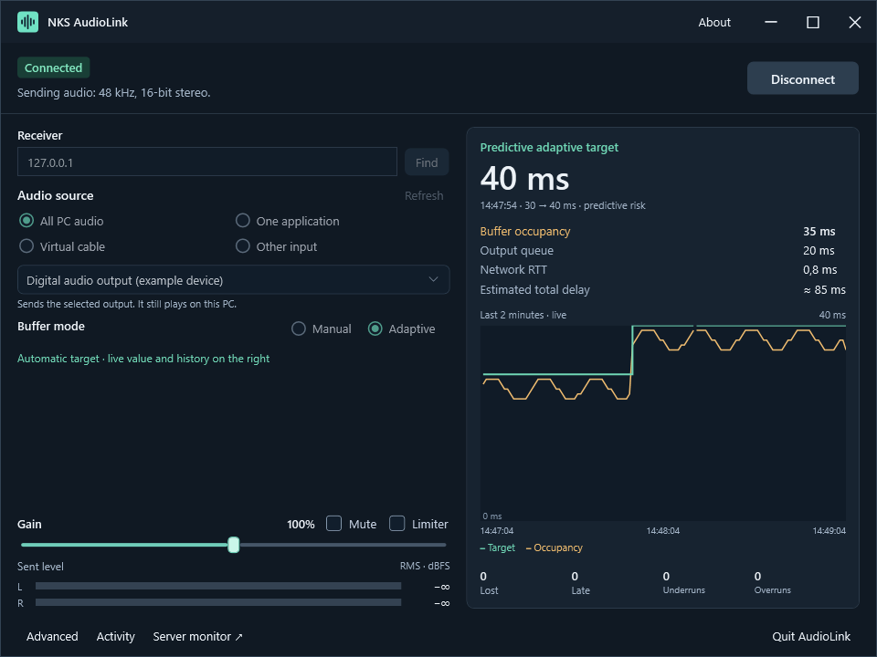
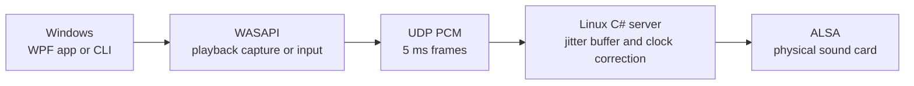

# NKS AudioLink

[](https://github.com/nks-hub/nks-audiolink/actions/workflows/ci.yml)
[](https://github.com/nks-hub/nks-audiolink/actions/workflows/release.yml)
[](CHANGELOG.md)
[](https://dotnet.microsoft.com/)
[](#how-it-works)
[](LICENSE)

> **Stream audio from a Windows PC to a Linux sound card over your local network.** The Windows client captures playback or an input device through WASAPI, the Windows audio API, and sends uncompressed stereo PCM over UDP. The C#/.NET 9 server plays it through ALSA, the Linux audio interface.

AudioLink provides a Windows WPF app, a command-line client and a Linux systemd service. Audio uses 48 kHz, 16-bit stereo samples in 5 ms frames. The server runs without PulseAudio, PipeWire or a desktop session. The transport is intended for a trusted LAN or VPN; physical end-to-end latency has not been measured.



Interface preview with controlled example values, rendered without opening audio devices. The optional [server dashboard](docs/INSTALL.md#optional-server-dashboard) adds live monitoring in a browser.

## Features

- 🎙️ **Four capture modes** - the full output of a selected playback device, one application and its children, a separately installed VB-CABLE virtual device, or another recording input. Virtual mode switches the Windows default output while connected and restores it on disconnect.
- 🔊 **Linux audio output** - direct ALSA playback as an unprivileged systemd service. WAV and null outputs are available for diagnostics.
- ⏱️ **Timing and recovery** - a jitter buffer absorbs short variations in packet arrival. Clock drift correction and silent frames keep the audio timeline running. The client reconnects after server outages and recreates capture after a device error.
- 📊 **Controls and statistics** - server discovery, target buffer, live gain adjustment, a system tray menu and statistics for buffer fill, output queue delay, network RTT, lost and late frames, underruns and overruns.
- 🖥️ **Desktop and web monitoring** - a compact borderless Windows app with a waveform icon, About and activity log; an optional read-only server dashboard with buffer history and a JSON statistics API on a separately configured HTTP port (suggested: 7356).
- 🎚️ **Stereo signal meters** - actual PCM RMS levels, held peaks and clipping indicators in the client and server dashboard. Server history retains up to one hour of signal, buffer and error measurements, with 1/5/15/60-minute graphs that survive page refresh.
- 🛠️ **Practical diagnostics** - manual 20/40/80 ms buffer presets, custom values, a redacted client diagnostic report, and separate native ALSA recovery counters.
- 🎯 **One application** - capture a selected Windows process and its children while leaving other applications out of the stream. Uses native process loopback without changing default audio routing; capability is checked at activation.
- 📶 **Predictive adaptive buffering** - optional automatic target adjustment within 20–100 ms using packet timing, bounded risk forecasts and hysteresis. Buffer mode, observed target, reason and target-versus-occupancy history stay visible in the client; manual timing controls are hidden in automatic mode.
- 🔇 **Live audio controls** - mute without losing the selected gain, optional stereo-linked peak limiting with 1 ms lookahead, and an explicit receiver takeover action after a busy rejection.
- 🔒 **Access control** - `allowCidrs` restricts client addresses. An optional shared key authenticates packets with HMAC. Audio is not encrypted.

[VB-CABLE](https://vb-audio.com/Cable/) is a separate VB-Audio driver. AudioLink does not bundle it; ordinary WASAPI loopback capture does not require it.

## Requirements

- Windows x64 for the WPF app and CLI client (WASAPI capture)
- Linux x64 with ALSA for the server; no PulseAudio, PipeWire or desktop session needed
- systemd for running the server as a service
- Portable packages bundle .NET runtime 9.0.20; building from source needs .NET SDK 9.0.203 or later within the 9.0 series
- Optional: [VB-CABLE](https://vb-audio.com/Cable/) for the virtual-device capture mode
- A trusted LAN or VPN between client and server

## Installation

### Portable packages

Version **0.1.0-rc.3** is the release candidate for the current review. Tagged builds provide `nks-audiolink-windows-x64.zip` and `nks-audiolink-linux-x64.tar.gz` on [GitHub Releases](https://github.com/nks-hub/nks-audiolink/releases). Both include .NET runtime 9.0.20, so the target machines do not need a separate runtime installation. The Windows archive contains `NksAudioLink.App.exe` and the CLI in `cli/`.

Successful pushes to `main` also produce both verified binary packages as downloadable artifacts in [CI](https://github.com/nks-hub/nks-audiolink/actions/workflows/ci.yml). Release candidates are marked **Pre-release**; the remaining subjective synchronization and physical cable checks are listed in [TODO.md](TODO.md). See [versioning and release instructions](docs/RELEASING.md) for the difference between CI artifacts, release candidates and stable releases.

From the extracted Linux package, run the installer in a root shell:

```sh
sh deploy/linux/install.sh ./NksAudioLink.Server
```

Edit `/etc/nks-audiolink/server.json` using [server.json.example](deploy/linux/server.json.example), especially `sink`, `allowCidrs` and any `pskBase64`, then run `systemctl enable --now nks-audiolink`. The installer installs the binary and unit but does not start or restart the service. See the [Linux installation guide](docs/INSTALL.md) for configuration and updates.

## Usage

On Windows, open `NksAudioLink.App.exe`, enter the server address or use **Find**, choose a source and select **Connect**. The [Windows guide](docs/WINDOWS.md) covers the app, CLI and optional virtual-device mode.

## How it works



The server accepts one active session. The default UDP port is `7355`. With its default configuration it accepts only local connections and uses the null output. Set `allowCidrs` and an ALSA device before using it across a network. See the [protocol reference](docs/PROTOCOL.md) for packet formats.

## Documentation

| Topic | Guide |
|---|---|
| Linux installation, configuration and operation | [docs/INSTALL.md](docs/INSTALL.md) |
| Windows app, CLI and optional VB-CABLE | [docs/WINDOWS.md](docs/WINDOWS.md) |
| UDP protocol | [docs/PROTOCOL.md](docs/PROTOCOL.md) |
| Tests, measurements and their limits | [docs/VALIDATION.md](docs/VALIDATION.md) |
| Progress and changes | [TODO.md](TODO.md) · [CHANGELOG.md](CHANGELOG.md) |
| Versioning, CI binaries and releases | [docs/RELEASING.md](docs/RELEASING.md) |
| Competitor comparison and development priorities | [docs/COMPETITION.md](docs/COMPETITION.md) |

## Development

Use .NET SDK **9.0.203 or later in the 9.0 series**, as allowed by [global.json](global.json). The highest installed compatible stable SDK is selected. CI tests both 9.0.203 and the release SDK, 9.0.318. On Windows:

```powershell
dotnet build NksAudioLink.sln -c Release
dotnet test NksAudioLink.sln -c Release
dotnet run --project src/NksAudioLink.App
```

If Visual Studio reports `NETSDK1141`, run `dotnet --list-sdks` and `dotnet --version` from the repository root. Install a compatible SDK if none is listed, then reopen the solution. SDK 9.0.203 is supported; SDK 9.0.318 is not required for a local build. See Microsoft's [SDK selection rules](https://learn.microsoft.com/en-us/dotnet/core/tools/global-json#rollforward).

To publish the Linux x64 server:

```sh
dotnet publish src/NksAudioLink.Server/NksAudioLink.Server.csproj \
  -c Release -r linux-x64 --self-contained true \
  -p:PublishSingleFile=true -o publish/linux-x64
```

## Testing

| Check | Result and scope |
|---|---|
| Automated tests | The RC3 review passed 171 portable Core/server/HTTP/queue/meter/DSP tests, 57 Windows client/CLI tests, 16 dashboard tests and 36 package/version/release-note tests. Core coverage from the portable suite is **96.52% of lines** and **88.98% of branches**. Real process isolation and authenticated adaptive-buffer integration have separate recorded evidence. |
| LAN and physical ALSA | The .NET 9.0.20 server and Windows client ran for **600 seconds with a 30 ms target buffer**. All 60 client samples showed zero lost or late frames, underruns and overruns. ALSA was RUNNING in all 120 samples; the server process and session remained unchanged. A separate 10 ms run accumulated late frames. |
| Tone and virtual mode | A 440 Hz Windows-to-Linux WAV test lasted 5.095 seconds with RMS 8,484 and no overruns or late frames. CABLE Input to CABLE Output transport was also confirmed by WAV analysis. |
| UI latency estimate | One live observation was **about 74 ms**: 10 ms WASAPI capture, about 15 ms client queue, a 5 ms frame, about 0.25 ms half-RTT, 25 ms server buffer and 19 ms ALSA queue delay. This is a sum of known stages, not a physical end-to-end measurement. |
| Measured LAN stage | Nine clicks took **22.96–37.88 ms**, median **31.39 ms**, from the Windows UDP send call to a Linux WAV write. This excludes WASAPI capture, ALSA playback and the receiver. |
| Server CPU | The 600-second physical ALSA run at 30 ms used **1.262% of one CPU core**, compared with about 3% before tuning. An isolated null-output test used 1.40%. |

The owner previously confirmed clean playback on the receiver. The physical ALSA/latency figures above are from the earlier 2026-10-02 run. The 2026-10-23 review reproduced and fixed a Windows sleep/resume socket failure, then verified automatic reconnection after real S3. A newer ten-minute run at a 40 ms target used 1.182% of one core but recorded one underrun; it is not a zero-error acceptance pass. The review subsequently fixed skipped output deadlines and added native ALSA recovery logging. A fresh 600-second run then passed with an unchanged process/session/ALSA trigger, zero jitter/native recovery events and 1.260% of one core. Video synchronization and physical network disconnection remain unverified. [Validation details](docs/VALIDATION.md) distinguish measurements from estimates; [TODO.md](TODO.md) tracks the remaining phases.

## Contributing

Contributions are welcome! For major changes, please open an issue first.

1. Fork the repository
2. Create your feature branch (`git checkout -b feature/amazing-feature`)
3. Commit your changes (`git commit -m 'feat: description'`)
4. Push to the branch (`git push origin feature/amazing-feature`)
5. Open a Pull Request

## Alternatives and scope

The [detailed comparison and action matrix](docs/COMPETITION.md) covers Scream, Snapcast, VBAN/Voicemeeter and SonoBus, with primary-source links checked on 2026-10-23. It compares capture/driver setup, formats, routing, monitoring and licensing. No competitor latency or recovery benchmark was performed.

AudioLink focuses on one Windows source and one Linux ALSA receiver: WASAPI loopback without an additional virtual driver, fixed 48 kHz/16-bit stereo, recovery and desktop/web diagnostics. [Scream](https://github.com/duncanthrax/scream) provides a virtual network sound device; [Snapcast](https://github.com/snapcast/snapcast) targets synchronized multiroom playback; [VBAN](https://vb-audio.com/Voicemeeter/vban.htm) serves broader mixer/routing workflows; [SonoBus](https://sonobus.net/) supports peer-to-peer audio collaboration.

The comparison separates completed SDK, audio recovery, UI, meter and packaging work from the two remaining physical acceptance checks and candidate publication. Multiroom synchronization, per-application capture, additional formats and interoperable transports remain separate product decisions, not features implied by the dashboard.

## Support

- 📧 **Email:** dev@nks-hub.cz
- 🐛 **Bug reports:** [GitHub Issues](https://github.com/nks-hub/nks-audiolink/issues)

## License

MIT License — see [LICENSE](LICENSE) for details. NAudio has its own MIT license; packages also include the licenses for the bundled .NET runtime. See [THIRD_PARTY_NOTICES.md](THIRD_PARTY_NOTICES.md).

---

<p align="center">
  Made with ❤️ by <a href="https://github.com/nks-hub">NKS Hub</a>
</p>
