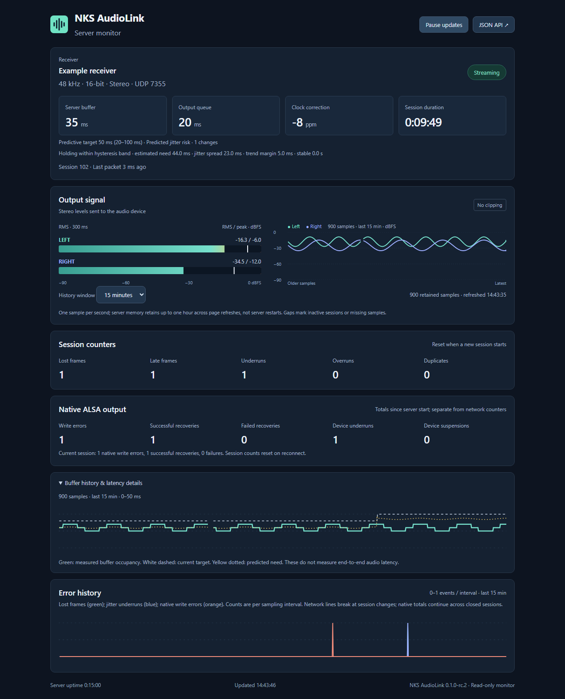

# Install the Linux server

The server is a C#/.NET 9 console application. On Linux, it writes directly to ALSA through `libasound.so.2`. It does not require PulseAudio or PipeWire. These instructions target an x86_64 Debian or Proxmox host with a physical sound device available through `/dev/snd`.

## Requirements

- The build machine needs .NET SDK 9.0.203 or later in the 9.0 series, as specified by `global.json`. The target needs `libasound.so.2`, systemd, an `audio` group, and a working ALSA device. A `--self-contained` build does not require a .NET runtime on the target.
- The target must accept UDP on the selected port, 7355 by default. Allow traffic only from a trusted LAN or VPN. PCM audio is not encrypted.
- Before changing the host, check that another application has not reserved the sound device. The installer does not open the device or start or restart the service.

## Build

From the repository root:

```sh
dotnet publish src/NksAudioLink.Server/NksAudioLink.Server.csproj \
  -c Release -r linux-x64 --self-contained true \
  -p:PublishSingleFile=true -o publish/linux-x64
```

Copy `publish/linux-x64/NksAudioLink.Server` and the `deploy/linux` directory to the target. Run the following command there in a root shell. On a machine with `sudo`, you can use `sudo sh ...`. The installer sets permissions on the installed binary.

```sh
sh deploy/linux/install.sh ./NksAudioLink.Server
```

The installer creates the unprivileged `nks-audiolink` user in the `audio` group. It places the binary in `/opt/nks-audiolink`, the systemd unit in `/etc/systemd/system`, and a sample configuration in `/etc/nks-audiolink/server.json` on first installation. Re-running it preserves the configuration and sets its ownership and mode to `root:nks-audiolink 0640`. It rejects symbolic links. Binary replacement is atomic, so files can be updated while the service runs; the new version takes effect after a planned restart. The installer only calls `systemctl daemon-reload`.

## Configure and start

Edit `/etc/nks-audiolink/server.json` before the first start. The sample allows only `127.0.0.0/8`. Set `allowCidrs` to the range of trusted clients. Do not use `0.0.0.0/0` without considering who can reach the server. To authenticate packets, set the same `pskBase64` on the server and client. The key must contain at least 16 random bytes. Keep configurations containing keys out of Git, and restrict access to root and the service group.

Set `sink` to `alsa:default` or, for example, `alsa:plughw:CARD=Device,DEV=0`. Find the ALSA identifier in `/proc/asound/cards` or the output of `NksAudioLink.Server devices`. `plughw` lets ALSA convert the format when a device does not directly accept stereo S16_LE at 48 kHz. The `audio` group must have access to the device. For a removable USB device, prefer a stable ALSA identifier over a card number, which can change after a reboot.

### Optional server dashboard

The server includes a read-only web monitor and `GET /api/stats`. HTTP is disabled by default (`httpPort: 0`). To enable local monitoring, add these fields to the server configuration:



Interface preview with controlled example values; validation measurements are recorded separately.

```json
"httpPort": 7356,
"httpBindAddress": "127.0.0.1"
```

After restarting the service, open `http://127.0.0.1:7356/` on the server, or forward that port over SSH. For a browser on another LAN machine, set `httpBindAddress` to the server's actual LAN IPv4 address, include the browser's subnet in `allowCidrs`, and allow the selected TCP port in the host firewall. Use an explicit address; wildcard bindings are rejected. Loopback monitoring accepts the loopback IP or `localhost` Host header. The desktop app's **Open server monitor** button uses the entered server address and its separate HTTP port, 7356 by default.

For a local diagnostic instance:

```sh
./NksAudioLink.Server run --sink null --port 17355 --http-port 7356
```

CLI values override the configuration file regardless of argument order. The dashboard refreshes once per second and shows server uptime, session duration, buffer and output queue occupancy, drift correction, and lost/late/underrun/overrun/duplicate counters. Stereo meters measure actual PCM after server playout processing and before the audio-device write: a 300 ms RMS window, peaks held for one second and clipping indication. These are digital dBFS readings, not physical speaker volume. Server queue values are not end-to-end latency measurements.

The server retains up to **one hour of numeric status and level samples at 1 Hz in memory** (at most 3,600 samples). Select **1, 5, 15 or 60 minutes** for the stereo levels, buffer and error graphs. History survives page refreshes and browser reconnection; **restarting the server clears it**. It contains no PCM, client address, shared key or configuration. HTTP disabled (`httpPort: 0`) also disables the history sampler and storage. The graphs leave gaps for inactive sessions, session changes and missing intervals; they do not interpolate across an outage. Native error totals continue across session changes.

**Pause updates** stops browser polling and clears live meters, while keeping counters and the historical graph labeled as stale. Server sampling continues. Resuming fetches missing samples; connection failures retain the labeled historical graph while clearing live values. Session network counters reset with each new session.

The **Native ALSA output** panel reports write errors, successful recoveries, failed recoveries, device underruns (`EPIPE`) and device suspensions (`ESTRPIPE`). These are separate from jitter-buffer underruns and packet counters. Top-level `nativeOutput` in `/api/stats` contains totals since server start, including closed/failed sessions. `session.nativeOutput` is relative to that session's start, or `null` for an output without ALSA diagnostics. A new session resets its own baseline; a server restart resets lifetime totals. Native events are also logged to the service journal. The error graph plots lost-frame, jitter-underrun and native-write-error increments between adjacent samples, rather than cumulative counts.

`GET /api/history?minutes=15` returns a bounded window with `epoch`, `nextSequence`, `reset`, `serverTimeMs` and `samples`. Each sample contains a sequence, UTC Unix timestamp in milliseconds, nullable numeric session status/levels and native totals. For subsequent polls, use `GET /api/history?minutes=15&after=LAST_SEQUENCE&epoch=LAST_EPOCH` to fetch only new samples. `minutes` accepts **1, 5, 15 or 60**; `after` must be a nonnegative integer. Invalid values return HTTP 400. Replace cached samples when `reset` is true or the epoch changes; this covers restarts and a cursor older than retained storage. Request a full window again when changing range. All responses are limited to 3,600 samples and use the same access restrictions as `/api/stats`. Sampling reflects the latest status each second; subsecond events are represented by cumulative counters, not an audio recording.

HTTP access uses the same `allowCidrs` as audio. The UDP shared key is neither returned nor used as an HTTP password. There are no web controls that change the server. Keep HTTP within the intended LAN or an SSH tunnel; it does not provide TLS or user login. The self-contained server includes the required ASP.NET Core runtime. A framework-dependent server needs both .NET and ASP.NET Core 9 runtimes.

### Optional adaptive jitter buffer

Manual buffering remains the default; installing the new server does not change existing clients or their saved target. A compatible client can opt in to predictive mode with `adaptiveBuffer: true`, `adaptiveMinLatencyMs` and `adaptiveMaxLatencyMs` (default bounds 20 and 100 ms). Bounds must be ordered multiples of 5 ms within 20–100 ms. The predictive initial target is independently **40 ms**, clamped into those bounds. The manual slider/presets are not predictive inputs, and the saved manual value is preserved for returning to manual mode. No server configuration switch is required.

The predictor compares monotonic packet arrival times with source sample positions before a dropout occurs. A bounded 512-packet window uses robust transit percentiles, a safety margin and a rising-risk forecast. It learns for at least 100 packets/0.5 seconds, then evaluates every 0.1 seconds. An increase requires three consecutive risk estimates at least 5 ms above target; the target rises up to 10 ms, at most once per two seconds of output frames. A decrease requires 30 seconds of clean full output frames with estimated need at least 10 ms below target, then lowers it by 5 ms. The separate thresholds and persistence form hysteresis, so small alternating changes do not cause oscillation. Actual underrun/loss/unique-late events retain a bounded fallback. Duplicates do not become new jitter observations; unique reordered packets are distinguished from duplicates. Pauses over 250 ms reset prediction warmup without resetting the learned target or session. Missing input cannot trigger a decrease.

Changes use the existing smoothly limited resampling correction; an actual underrun refills to the updated target. There is no reconnect, source-timeline reset or deliberate frame discard just to reduce latency. Native ALSA recovery counters do not drive this policy. RC1 clients retain their explicitly negotiated legacy reactive policy; a predictive client requires the newer capability acknowledgment and will not label an RC1 server as predictive.

After an actual underrun/loss/unique-late event, a learned safety hold blocks decreases for 120 seconds of clean full playback. Rare delayed packets that threaten this margin renew the hold, even when the robust percentile filters them out of the main prediction. They cannot raise the target by themselves. After these bursts stop, the hold expires and gradual settling resumes. This avoids repeatedly forgetting a known rare-delay pattern; it cannot predict unseen spikes or guarantee uninterrupted audio on an unbounded network.

The dashboard shows manual/reactive/predictive mode, actual target, limits, last reason and change count. Its buffer graph overlays the target as a white dashed line and predicted need as a yellow dotted line. `/api/stats` and server history expose `session.targetLatencyMs`, nullable `session.adaptiveBuffer` (`targetMs`, `minimumMs`, `maximumMs`, `reason`, `changes`, `predictive`) and nullable `session.predictor`. Predictor fields include estimated need, transit spread, trend margin, sample/warmup status, risk confirmation and clean-playback progress. States distinguish learning, waiting for audio, risk confirmation, cooldown, learned failure hold, stable settling, the hysteresis band and the maximum target. UDP delivers the target/reason/capability independently of HTTP. Older servers explicitly reject predictive negotiation; use manual mode with them. See the [wire contract](PROTOCOL.md#hello-body).

Adaptive target is only the network buffer budget, not total audio latency. A larger ceiling trades latency for dropout tolerance; it cannot guarantee dropout-free playback or an end-to-end delay below 100 ms. The policy has deterministic stream and negotiation tests; physical-network acceptance must identify whether manual or adaptive mode was actually running.

### Service control

```sh
systemctl enable --now nks-audiolink
systemctl status nks-audiolink
journalctl -u nks-audiolink -f
```

For an update, run the installer again and restart the service at an agreed time:

```sh
systemctl restart nks-audiolink
```

The server opens ALSA only when it accepts a session. `BYE` ends the session immediately. The server releases the sound device after `idleReleaseSec` from the last packet; the default is 5 seconds. For a short isolated test without a sound device, run the server manually with `--sink null` or `--sink wav:/tmp/tone.wav`. The process user must be able to write the WAV file.

### CPU settings

The Linux build sets `System.Threading.ThreadPool.UnfairSemaphoreSpinLimit=0` to stop idle threads from spinning. The systemd unit also sets `DOTNET_SYSTEM_NET_SOCKETS_INLINE_COMPLETIONS=1` and `DOTNET_SYSTEM_NET_SOCKETS_THREAD_COUNT=1`. Network completions for one UDP socket then run on one socket thread. A separate playback thread still writes audio to the device.

In an isolated test without a sound device on .NET 9.0.20, these settings reduced CPU use from 3.87% to 1.40% of one core, with no underruns or late frames. During the 2026-10-02 ten-minute stream to physical ALSA with a 30 ms target buffer, the server used 1.262% of one core and every sampled client error counter remained zero. A separate test at 10 ms produced late frames. See [validation evidence](VALIDATION.md) for newer results and their scope. Opening and closing the output on `HELLO` may briefly hold up the network thread. To compare settings on your host, override them in a systemd drop-in and check the statistics after a planned restart. Running the binary directly does not inherit those two systemd environment variables.

The [.NET 9.0.20 implementation](https://github.com/dotnet/runtime/blob/v9.0.20/src/libraries/System.Net.Sockets/src/System/Net/Sockets/SocketAsyncEngine.Unix.cs) documents the socket behavior.

## Verify

```sh
/opt/nks-audiolink/NksAudioLink.Server devices
getent group audio
id nks-audiolink
```

On Windows, send a test tone with the client CLI. Supply the address and, if needed, the key for your network.

```powershell
dotnet run --project src/NksAudioLink.Cli -- test-tone --server SERVER_IP --seconds 10
```

The CLI prints buffer occupancy, underruns, overruns, and lost packets. To check the physical output, select the receiver input connected to the sound device and listen for the tone. Starting the service alone does not verify sustained playback or latency. If late frames or underruns increase, raise the target buffer. The default 30 ms provides more margin than a manually selected 10 ms.

For problems, check `journalctl -u nks-audiolink`, access to `/dev/snd`, the `sink` and `allowCidrs` settings, and the incoming UDP port. `ALSA open` often means that the device is absent or busy. The service does not need PulseAudio, PipeWire, or a desktop session.

The displayed underrun and overrun counters describe the server's jitter buffer. Native sound-device errors are separate: `ALSA recovery` journal entries include the native error, recovery result and cumulative playback-underrun/suspension totals. Successful repeated recoveries are rate-limited and summarized; failures are logged immediately. Session-close records also include maximum playback scheduling lateness and discarded deadlines. Check these records when audio glitches occur despite zero network/jitter counters.
